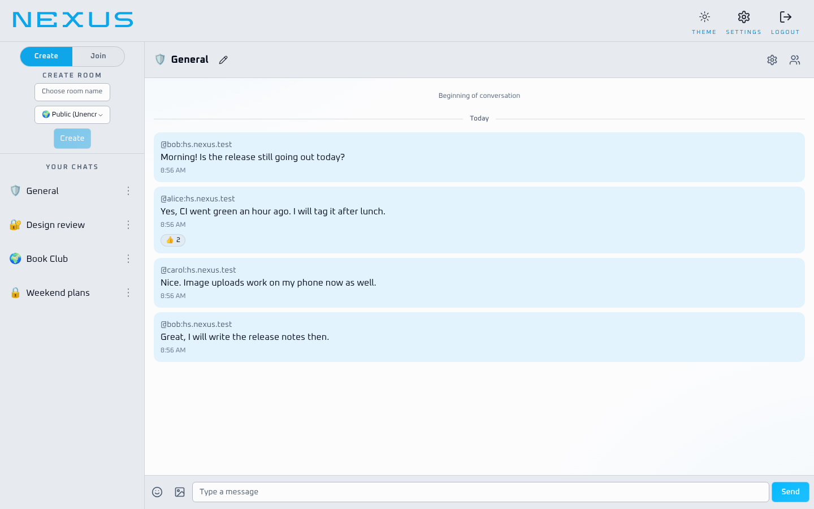
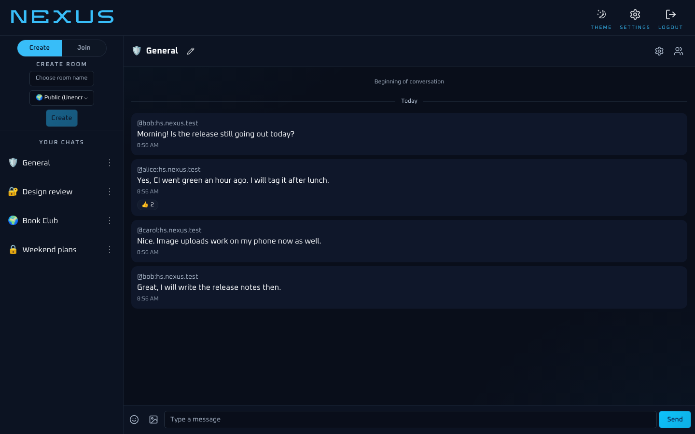
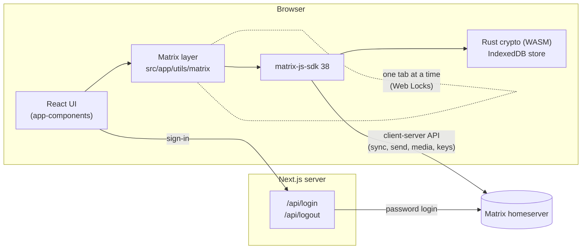

# Nexus


Nexus is an end-to-end encrypted chat client for the [Matrix](https://matrix.org) protocol. I built it with Next.js 14, React 18 and `matrix-js-sdk`, whose Rust crypto engine does the encryption in the browser.

**Live demo:** [erikm9-nexus.vercel.app](https://erikm9-nexus.vercel.app). It signs in to matrix.org, so any matrix.org account works, and the Sign up button registers one in a minute if you don't have one. For a chat with someone, invite a second account of your own, or `@yourname:matrix.org` from another client such as Element.

| Light | Dark |
|---|---|
|  |  |

## Features

- End-to-end encryption with the Rust crypto engine: encrypted rooms and attachments, device verification by emoji, recovery keys and server-side key backup
- Threads, replies, edits, reactions, deletion, date separators and history which loads as you scroll up
- Image uploads, compressed first when they are large, and received images, audio, video and files shown in the chat
- Public and private rooms: create them, join by name, alias or ID, invite people, and manage roles, kicks, bans, privacy and encryption
- Sessions which survive a flaky network and refresh their own access tokens, a sign-out which revokes the session on the server, and a guard which runs Nexus in one tab at a time, so two tabs can't corrupt the crypto store
- Light and dark themes, a phone layout and full keyboard access

## How it works



Everything Matrix-related lives in `src/app/utils/matrix/`. `client.ts` starts the client and keeps retrying when the network is flaky, `session.ts` and `crypto.ts` look after the stored session and a separate crypto store for every account, `recovery.ts` and `storage.ts` handle recovery keys and the key backup, `verification.ts` runs device verification, `devices.ts` finds the room members' devices this session hasn't verified yet, `permissions.ts` applies the power-level rules and `tabLock.ts` is the one-tab lock. The components reach it through the `src/app/utils/matrix.ts` barrel, apart from the permission rules, which `ChatHeader` and `ChatList` import directly.

The chat view in `src/app/app-components/timeline/` is built again from the SDK's own timeline whenever it changes (`model.ts`, `useRoomTimeline.ts`), so edits, deletions, relations and send states follow the SDK's rules. Decrypted media is cached behind object URLs whose media type comes from an allow-list (`useMediaCache.ts`).

Password login goes through a route on the Next.js server (`src/app/api/login`), which checks the homeserver's reply before passing it on. Signing out goes through the SDK, with a second route (`src/app/api/logout`) as the fallback when the SDK can't do it.

## Running it locally

You need Node.js 22 or newer, which `matrix-js-sdk` 38 requires (CI uses Node 22), and a Matrix account on any homeserver. matrix.org works fine.

```bash
npm install
cp .env.example .env   # point both variables at your homeserver if it isn't matrix.org
npm run dev
```

Then open http://localhost:3000 and sign in with your Matrix username and password.

| Variable | What it's for |
|---|---|
| `MATRIX_HOMESERVER` | The homeserver which the `/api/login` and `/api/logout` routes call. After signing in, the browser talks to the base URL which the login route reports: the homeserver's own client URL when its login reply names one, and this URL otherwise. |
| `NEXT_PUBLIC_MATRIX_HOMESERVER` | Used instead of `MATRIX_HOMESERVER` when that one isn't set. |

## Scripts

| Command | What it does |
|---|---|
| `npm run dev` | Development server on port 3000 |
| `npm run build` / `npm start` | Production build and server |
| `npm run lint` / `npm run typecheck` | ESLint over `src/` and `tests/`, and the TypeScript check |
| `npm test` / `npm run test:coverage` | Unit and component tests, the second one with coverage and its thresholds |
| `npm run test:watch` / `npm run test:ui` | The same tests in watch mode or in Vitest's browser UI |
| `npm run test:e2e` | Builds and starts the app (unless it's already running on port 3000) and runs every Playwright spec against it |
| `npm run test:e2e:smoke` | Only the critical journeys |
| `npm run test:e2e:a11y` | Only the axe accessibility scans |
| `npm run test:e2e:headed` | The Playwright specs with the browser window visible |
| `npm run test:all` | Unit and component tests, then the Playwright specs |
| `npm run verify` | Lint, type check, unit and Playwright tests in one go |

## Testing

| Level | Tool | Tests |
|---|---|---|
| Unit | Vitest | 466 |
| Component | Vitest and Testing Library, in jsdom | 432 |
| End-to-end | Playwright, on a production build | 177 |

### Why these tools?

In my smaller projects I picked the testing tools so I could learn how various testing tools work. For Nexus I went with Vitest, Testing Library, user-event, Playwright and axe-core, because they fit the project best and were the practical choice.

- Vitest runs the TypeScript and TSX files as they are, with the same `@` path alias as the app, and loads `matrix-js-sdk`, which is published only as ES modules, without any extra setup. It runs the components in jsdom and the API routes in Node, and it has fake timers, a watch mode, a browser UI and coverage thresholds of its own.
- Testing Library and user-event find elements by their role, label and text and use them the way a person would, so the component tests check what the user sees and does instead of the components' internals.
- Playwright's `page.route` is what makes the fake homeserver possible, since it lets the test process answer the browser's requests. Playwright also runs the Rust crypto WebAssembly and IndexedDB in a real Chromium, sets the clock, time zone and locale for the timeouts and date separators, opens a second tab for the one-tab lock and keeps traces, screenshots and videos of the tests which fail.
- axe-core runs the WCAG 2.1 A and AA scans through `@axe-core/playwright`.

### Unit and component tests

The unit tests cover the logic with clear inputs and outputs: dates, the media types the app will show and how an image gets uploaded, the upload retry, the power-level rules, the stored session, recovery keys, verification, the tab lock, the start-up and sign-out of the Matrix client, and the two Next.js routes, which run in Vitest's Node environment against a stubbed `fetch`.

Wherever code reads Matrix state, the tests use real SDK objects. `tests/unit/support/matrixRoom.ts` and `tests/unit/timeline/sdk-fixtures.ts` build a real `MatrixClient` with an in-memory store and real `Room` and `MatrixEvent` objects, fed the way sync feeds them, so the SDK's own logic for power levels, edits, deletions, relations and send states runs inside the tests. Recovery keys go through the SDK's real encoding and key check, and attachments are encrypted with real Web Crypto. Doubles only stand in at the network boundary, for the client lifecycle in `client.test.ts`, for the Matrix module where a component calls into it, and for the browser APIs jsdom doesn't have (IndexedDB and Web Locks), and they're shaped like the real thing.

The component tests render the React components with Testing Library and drive them with user-event, checking what a user sees and does: roles, labels, text and where focus goes. They cover what is hard to reach end to end, like failures and error codes, late answers which arrive after the user has moved on, IME composition, focus inside dialogs and what happens when the session ends while a panel or dialog is open.

### End-to-end tests

Playwright drives the production build (`next build` and `next start`) in Chromium. The app runs for real, `matrix-js-sdk` and its Rust crypto WebAssembly included, against a fake Matrix homeserver in `tests/e2e/support/homeserver.ts`. The fake runs in the test process and answers the browser's requests through `page.route`, so the specs need no Matrix server and make no network requests of their own. The fonts are in the repository, so the build doesn't download anything either.

The fake keeps state the way a real server does: rooms, membership and state events, a sync stream with long-polling and gappy syncs, history pages, redactions, media upload and download (on the legacy and the authenticated endpoints), key backups, device keys signed with ed25519, to-device messages, the room directory and refresh tokens which expire and rotate. Tests can also break it on purpose: `failNext()` answers the next matching request with an error, `delay()` holds a request back, `setReachable(false)` takes the server offline and `expireAccessTokens()` expires every access token.

Every test gets its own fake (`tests/e2e/support/fixtures.ts`), seeded through its API (`addRoom`, `say`, `inviteMe`, `addDevice` and so on), so no state is shared between tests. A catch-all route aborts any request to another origin, and the fixture fails the test if the app tried to make one. The fake also records every request, which lets a test check what reached the server (`requestsTo()`, `sentEvents()`), for example that an encrypted upload carries no file name.

The app's own `/api/login` and `/api/logout` routes run on the Next.js server, which `page.route` can't reach, so the specs which sign in answer them with `mockAppApi()` and the real routes are covered by their unit tests.

The locators and user journeys live in one page object, `tests/e2e/support/nexus-page.ts`, so the specs read as behaviour and a change in the UI only needs fixing in one place.

| Spec | What it covers | Tests |
|---|---|---|
| `auth.spec.ts` | Signing in, stored sessions, token refresh, logging out and switching accounts | 23 |
| `connection.spec.ts` | Slow and unreachable homeservers, start-up races and the crypto WebAssembly download | 6 |
| `session.spec.ts` | Recovery keys, restoring the key backup, verifying the session, more than one tab and forgetting the session | 21 |
| `message-flow.spec.ts` | Reading and sending, date separators, replies, edits, deletion, reactions, threads, encrypted rooms and keeping the view in place | 31 |
| `file-uploads.spec.ts` | Picking, checking, compressing, encrypting and receiving attachments | 18 |
| `room-management.spec.ts` | The room list, creating and joining rooms, the room menu in the list and in the header, sending invitations and leaving | 32 |
| `room-settings.spec.ts` | Renaming, privacy, encryption, members, roles, moderation and verifying devices | 20 |
| `invites.spec.ts` | Invitations I receive | 6 |
| `app-shell.spec.ts` | The theme, keyboard access to the header, the phone layout and the axe scans | 11 |
| `layout.spec.ts` | Labels centred in their buttons and pills, the spacing of the sign-in card and menus that hide what lies behind them | 9 |

### Tags

`@smoke` marks the 12 critical journeys: signing in, reading and sending messages, sending an encrypted image, creating and joining rooms, accepting an invitation, creating a recovery key and logging out. CI runs them first, so a broken build fails within a couple of minutes. `@a11y` marks the 5 axe scans. Everything else only runs in the full suite.

### How I write the tests

- One behaviour per test, with a title in the present tense which says what happens from the user's side ("keeps the open chat when another room is left"), never "should..." and never implementation details
- Arrange, act and assert, separated by blank lines. Everything a test needs is seeded through the fake homeserver or the component's props, and no test depends on another one or on the order they run in
- Accessible locators first: `getByRole`, `getByLabel` and `getByText` come before test IDs and CSS selectors, which I only use where nothing accessible exists
- No fixed sleeps. The tests wait with web-first assertions and `expect.poll`, and anything time-based uses Playwright's clock or Vitest's fake timers
- Doubles have to behave like the real thing: real `MatrixError` and `ConnectionError` classes, real enum values, real `Device` objects and real recovery keys. A test which only passes because of an impossible mock gets rewritten or deleted
- The security tests check the safe outcome (for example that a received HTML file becomes an `application/octet-stream` blob) with harmless content, and none of them contains a working exploit
- Quiet output: expected console output is checked with a spy instead of being printed, and the SDK's logger is silenced in `tests/setup.ts`

### Accessibility

axe-core scans the sign-in page and the chat screen in both themes with the `wcag2a`, `wcag2aa`, `wcag21a` and `wcag21aa` rules, and another scan checks the member actions menu. The scans leave out the colour contrast rule, because the palette is a design choice which I've kept as it is instead of darkening it to the AA ratios. The keyboard journeys (opening rooms, room menus, reactions, header menus and member actions) are tested with the keyboard alone, including where focus goes.

### Coverage

`npm run test:coverage` measures the unit and component tests over `src/`, and CI fails when coverage drops below the thresholds in `vitest.config.ts`: 92% of lines and statements, 85% of branches and 90% of functions, a few points under the current figures. The generated shadcn/ui primitives, the page shells and the client bootstrap are left out, since they only wire components together and the Playwright suite covers them end to end.

### CI

GitHub Actions runs `.github/workflows/ci.yml` on every push and pull request to `main`, in three jobs which each wait for the one before:

1. Lint and type check
2. The unit and component tests with coverage, whose report is uploaded as an artifact
3. The end-to-end tests: a production build, the `@smoke` tests first and then the rest of the suite on one worker with two retries. When anything fails, the HTML report, traces, screenshots and videos are uploaded and the failures are annotated on the pull request

### Known limits

- The suite only runs in Chromium, the engine I checked the fake homeserver and the Rust crypto WebAssembly against. Firefox and WebKit projects can be added to `playwright.config.ts`
- The fake homeserver isn't Synapse. It implements the parts of the client-server API which the app uses, following the Matrix spec, but it doesn't check power levels or membership on the server side, so a nightly run against a real homeserver in a container would catch more
- Playwright can't drive a real input method editor, so IME composition is covered by component tests which send composing keyboard events
- jsdom can't decode images or draw on a canvas, so image compression is only tested end to end

## Project structure

```
src/
├── app/
│   ├── api/login, api/logout     # Server-side login and logout routes
│   ├── app-components/           # Chat UI: header, room list, chat window, composer, overlays
│   │   └── timeline/             # Timeline model, room timeline hook, media cache, reaction picker
│   ├── auth/page.tsx             # Sign-in page
│   ├── utils/
│   │   ├── matrix/               # Matrix client lifecycle, crypto, recovery, verification, permissions, tab lock
│   │   ├── matrix.ts             # Public API of the Matrix layer
│   │   ├── ClientShell.tsx       # Client-only shell with the Matrix start-up, the header and the overlays
│   │   └── dates.ts, media.ts, upload.ts, image-upload.ts, keyboard.ts, helpers.ts, global.ts
│   ├── client-init.tsx           # Starts the client for the stored session
│   ├── layout.tsx, page.tsx      # App shell and chat page
│   ├── fonts/                    # Oxanium, the interface font, and Geist Mono, for the recovery key field
│   ├── icon.svg                  # Favicon
│   └── globals.css
├── components/ui/                # shadcn/ui primitives
├── lib/utils.ts
└── types/                        # Ambient declarations for CSS imports and window globals

public/
└── fonts/                        # The wordmark's typeface

tests/
├── setup.ts                      # jsdom setup shared by the unit and component tests
├── unit/                         # Vitest: matrix/, timeline/, utils/, api/, components/, support/
└── e2e/                          # Playwright specs by feature
    └── support/                  # Fake homeserver, page object, fixtures, image and theme helpers

docs/
└── images/                       # README screenshots
```

## Deployment

The demo runs on [Vercel](https://vercel.com), which builds Next.js apps as they are: the pages are served from its CDN and the two API routes run as serverless functions. To deploy a copy, import the repository as a new project, leave the framework preset on Next.js, set the environment variable `MATRIX_HOMESERVER` (`https://matrix.org` for the demo) and press Deploy; every later push to `main` deploys by itself. The `engines` field in `package.json` picks Node 22 there, as `matrix-js-sdk` needs it, and the two routes declare a `maxDuration` of 20 seconds, as they wait up to 10 and 15 seconds for the homeserver.

Any host which runs `next build` and `next start` on Node 22 works the same way; the only setting it needs is `MATRIX_HOMESERVER`. Serve it over HTTPS (or on localhost), because the browser only exposes the Web Crypto API, which the client's own encryption helpers use, in a secure context.

## Security notes

- The access and refresh tokens, the device ID and the key which encrypts the crypto store live in `localStorage`, tied to the signed-in account. Logging out revokes the session on the server and removes all of them, together with the account's crypto store in IndexedDB. Forget this session (in Settings) also wipes every account's Matrix data from the browser.
- A recovery key is only remembered in `localStorage` once it has been checked against the account's secret storage, so it can unlock the key backup on later visits. Logging out removes it.
- Attachments are shown from `blob:` URLs whose media type comes from an allow-list, so a received file can never run as a page on the app's origin.

## Licence

MIT